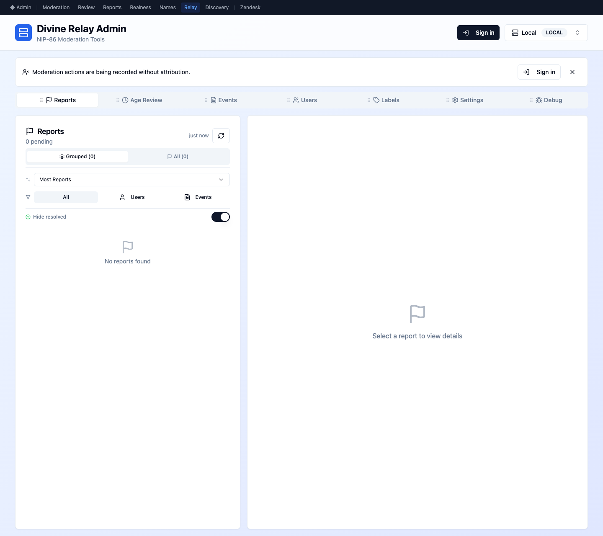
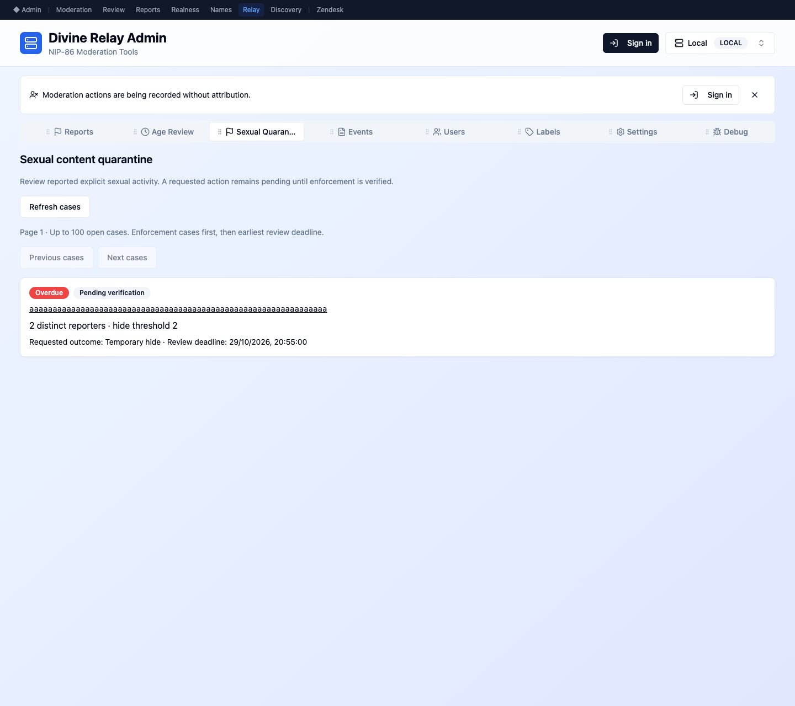
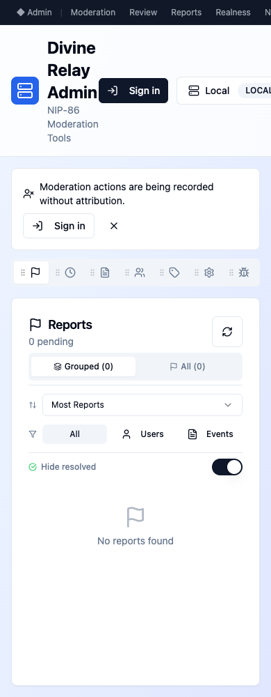
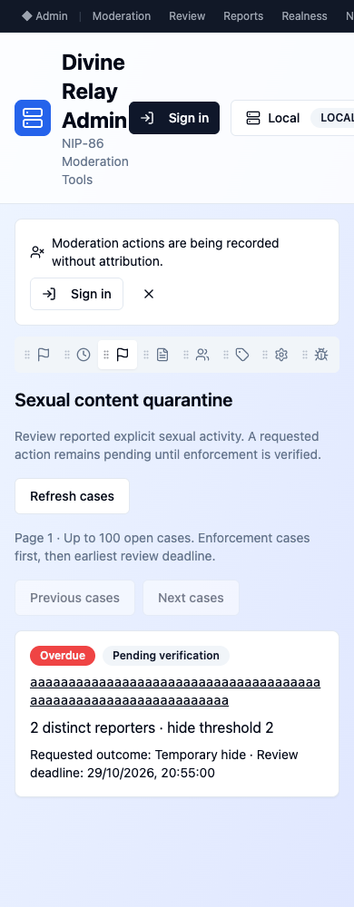
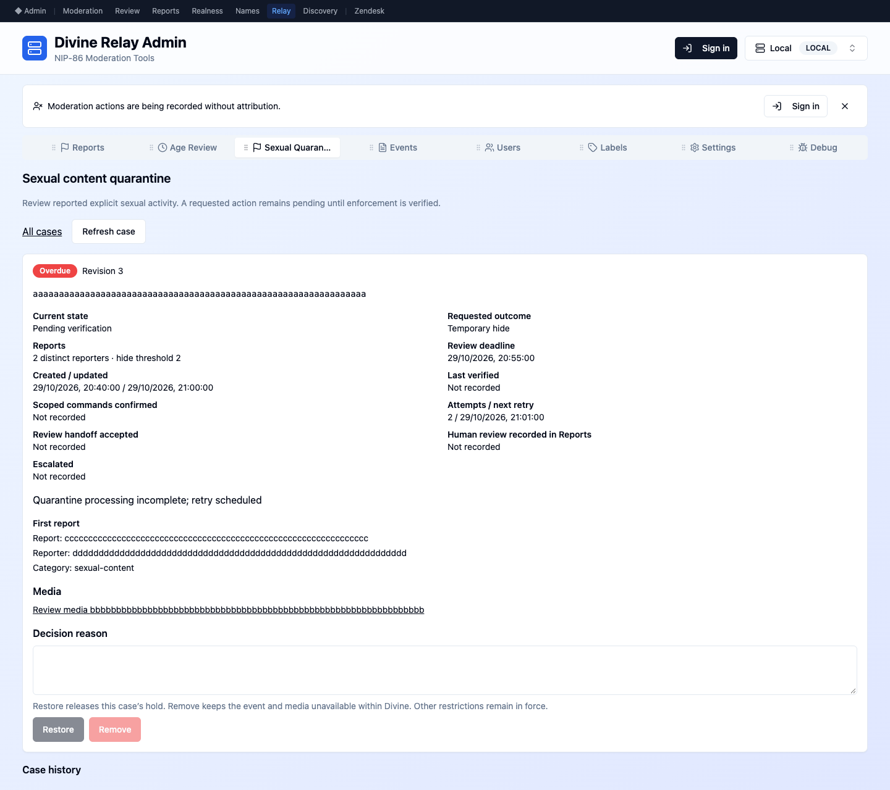
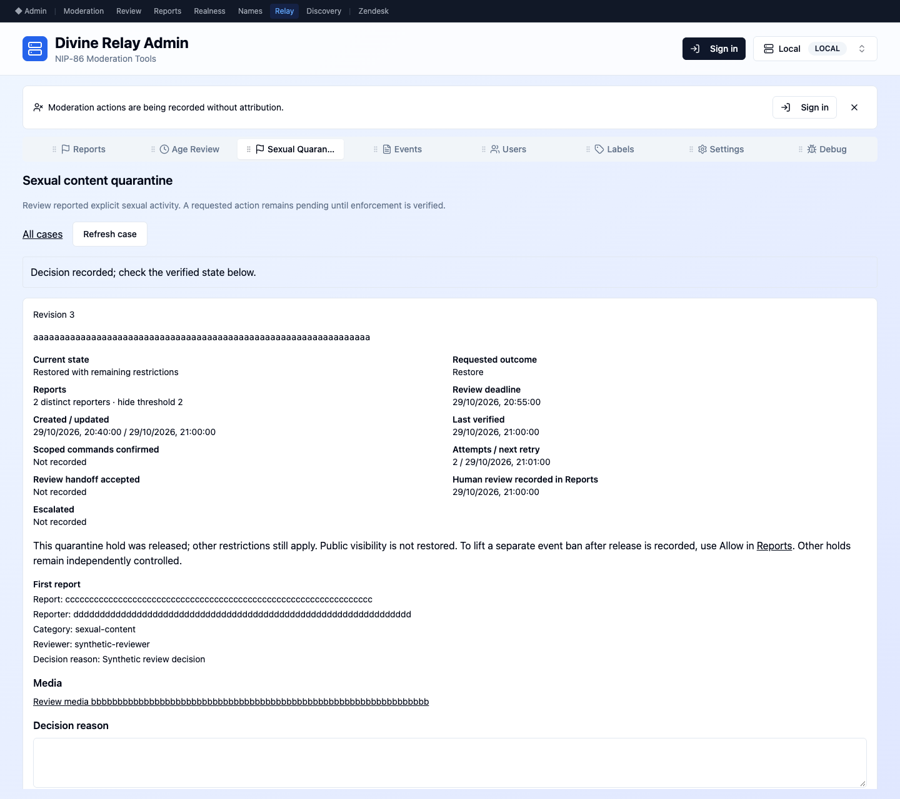
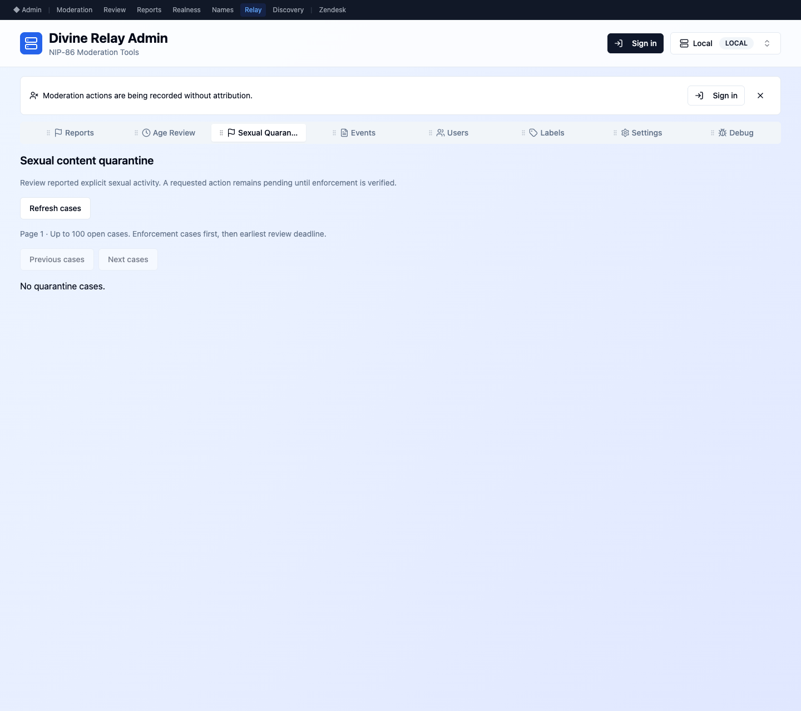
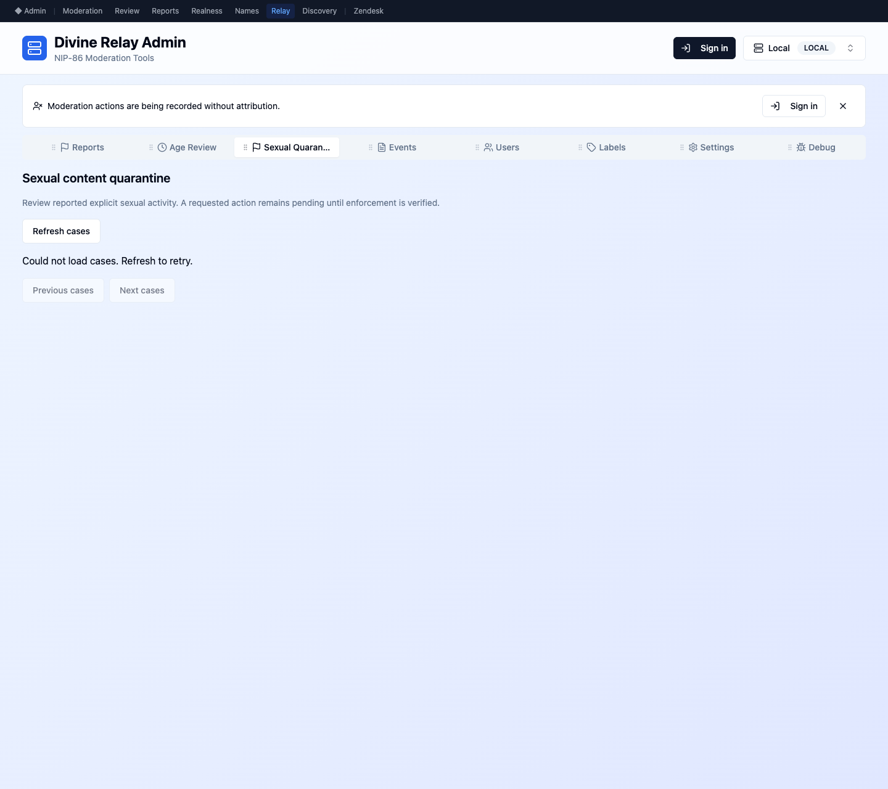

# Synthetic reviewer UI captures

Before source: `ddf6da544feab172bcb57a0f8d697cb1ba6e38f7` in an isolated detached worktree.
After source: `c99ab190171f77634e15a741be976792ec0f6eb9` (refreshed 2026-10-30).
The artifact commit adds only these captures and their provenance. The original before captures are preserved; all six after captures include priority paging, command acknowledgment and the separate base-ban guidance.

Captured with Playwright and headless Google Chrome in a new browser context,
light theme, 1440×1280 desktop and 390×1000 mobile viewports. Capture command:
`node /tmp/sexual-quarantine-ui-refresh.mjs` (preinstalled browser runtime, no
repository dependency changes). The initial before revision ran in its own local Vite process and working directory. The refresh ran the current isolated worktree on loopback port 58181 with an empty env directory and synthetic API configuration.

The old entry point is `/reports`; the new screen is `/sexual-quarantine`.
Open the synthetic full-ID case to reach its detail view. The browser intercepts
all API calls with synthetic fixtures and blocks other external requests and
WebSockets. No production account, credential, case, media, or end-user data was
loaded. IDs use repeated hexadecimal fixture characters; there is no sexual media.

The exercise verified Restore is disabled without a reason, submits the viewed
revision with the reason, and shows the verified remaining-restrictions outcome.
Empty and service-error responses were captured separately. Every image was
visually inspected. The base screenshots show the previous entry point because
this case workflow did not exist in the base revision.

| Before | After |
| --- | --- |
|  |  |
|  |  |

